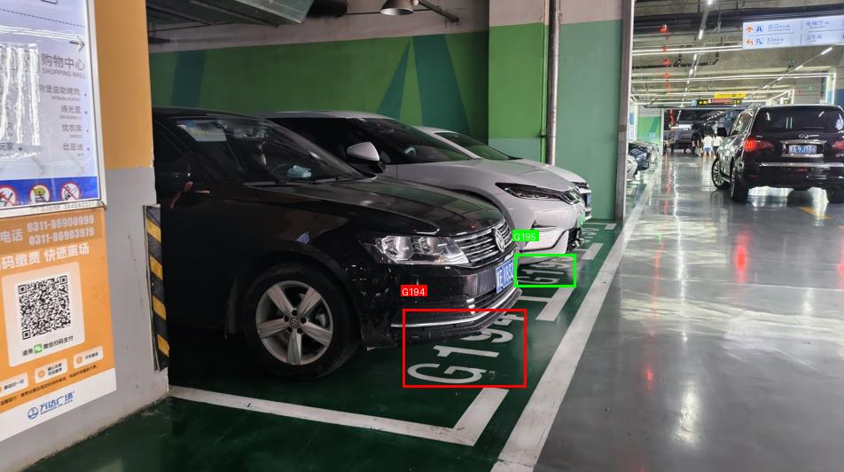
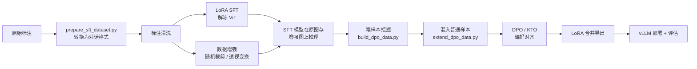

# 智慧寻车：基于 Qwen3-VL-2B 后训练的车位号识别与定位

在地下停车场场景中，用户拍一张照片，模型直接输出画面中**车位号的文本和边界框**，用于"停车后记录车位 / 返回时寻车"。

本项目以 **Qwen3-VL-2B-Instruct** 为基座，通过 **LoRA SFT → 难样本挖掘 → DPO / KTO 偏好对齐** 的后训练流程，并用 **vLLM** 部署推理。在 500 张测试图上，2B 小模型的主指标达到 **89.2%**，明显高于 qwen3-vl-plus、doubao-seed-2.0-lite、gemini-3-flash 等商业多模态大模型（74.8%–78.0%），首 token 延迟约 **80 ms**。

<p align="center">
  
  <br/>
  <em>DPO 模型在测试集上的预测可视化（同一画面内识别出多个车位号）</em>
</p>

---

## 目录

- [任务定义](#任务定义)
- [整体流程](#整体流程)
- [实验结果](#实验结果)
- [项目结构](#项目结构)
- [快速开始](#快速开始)
- [评估指标说明](#评估指标说明)

---

## 任务定义

**输入**：一张停车场照片 + 固定指令

```
你是一个专业的车位号识别助手。请观察图片，输出车位号的位置与编号。
输出json格式：[{"text_content": text, "bbox_2d": [x1, y1, x2, y2]}, ...]
```

**输出**：JSON 数组，每个元素包含车位号文本和边界框。坐标采用 Qwen3-VL 原生的 **0–1000 相对坐标**；画面中没有车位号时输出 `[]`。

```json
[{"text_content": "168", "bbox_2d": [833, 828, 962, 884]}]
```

**数据规模**：训练集 2,500 张，测试集 500 张。测试集中 0 / 1 / 2 / 3 个车位号的图片分别为 101 / 260 / 127 / 12 张，包含负样本和多目标场景。

---

## 整体流程



### 1. 数据准备

`sft/prepare_sft_dataset.py` 将原始标注（`label` + `bbox`）转换为 LLaMA-Factory 的 ShareGPT 对话格式，丢弃标签为"无"的框，没有车位号的图片保留为 `[]` 负样本。

在分析 SFT 模型的错误时发现了一批标注问题（漏标、错标），清洗后得到 `*_correct.json` 版本的数据集（测试集 GT 框数由 542 修正为 550）。

### 2. LoRA SFT

配置见 `sft/qwen3vl_lora_sft_train.yaml`，基于 LLaMA-Factory：

| 参数 | 值 |
|---|---|
| 基座 | Qwen3-VL-2B-Instruct（`qwen3_vl_nothink` 模板） |
| LoRA | rank 16，`lora_target: all` |
| 学习率 / 调度 | 1e-4，cosine，warmup 0.1 |
| Batch / Epoch | 8 / 5 |
| 图像分辨率 | `image_max_pixels: 1000000` |
| 视觉部分 | **解冻 ViT**，冻结多模态 projector |

**关键发现：解冻 ViT 带来最大的单项提升**（主指标 74.0% → 87.0%）。车位号是地面上的倾斜、透视变形的喷涂文字，与通用预训练分布差异较大，仅调语言部分不足以让视觉编码器学到这类特征。

### 3. 数据增强（用于难样本挖掘）

`augument/` 下的两个脚本基于 albumentations，在变换图像的同时同步调整 bbox：

- **`apply_crop_transform.py` 随机裁剪**：单目标时保证目标框完整保留在裁剪区域内；多目标时随机裁剪 60%–90%，只保留可见度 ≥ 95% 的框，模拟"只拍到部分车位"的情况。
- **`apply_perspective_transform.py` 透视变换**：模拟不同拍摄角度，可见度阈值设为 0.99–1.0，并剔除紧贴图像边缘的框，避免车位号文字被截断后标签失真。

### 4. 难样本挖掘 → 偏好数据构建

用 SFT 模型在原始训练集与增强训练集上推理，将预测结果与 GT 对比：

- **`dpo/build_dpo_data.py`**：选出"预测中面积最大的框，其文本不在 GT 中"的样本作为难样本。对透视增强集只保留**预测框多于 GT 框**（多检 / 幻觉）的样本。构造 `chosen = GT`，`rejected = SFT 预测`。
- **`dpo/extend_dpo_data.py`**：再随机混入 500 条 SFT 已经答对的普通样本（剔除 GT 和预测都为空的样本），防止偏好训练只盯着难样本导致整体能力退化。混入数量 500 是调参后的结果。

### 5. DPO / KTO 偏好对齐

配置见 `dpo/qwen3vl_lora_dpo_train.yaml`，在合并后的 SFT 模型上继续训练 LoRA：

| 参数 | 值 |
|---|---|
| `pref_loss` | `sigmoid`（DPO）/ `kto_pair`（KTO） |
| `pref_beta` | 0.1 |
| `pref_ftx` | 0.2（混入 SFT loss，稳定训练） |
| 学习率 / Epoch | 5e-6 / 1 |
| 视觉部分 | 解冻 ViT 和多模态 projector |

### 6. 部署

合并 LoRA 权重后用 vLLM 提供 OpenAI 兼容接口（`vllm_server.sh`），`predict.py` 以流式请求方式推理并统计 TTFT / TPS。

---

## 实验结果

所有结果均在 500 张测试图上得到，温度为 0。

### 消融实验

| 设置 | 测试标注 | 主指标<br/>最大框准确率 | 文本 F1 | 检测 F1<br/>(IoU≥0.5) | 端到端 F1 | 整图精确匹配 |
|---|---|---|---|---|---|---|
| SFT，冻结 ViT | 原始 | 0.740 | 0.695 | 0.879 | 0.661 | 0.646 |
| SFT，解冻 ViT | 原始 | 0.870 | 0.850 | 0.934 | 0.824 | 0.800 |
| SFT，解冻 ViT（标注清洗后） | 清洗后 | 0.884 | 0.846 | **0.944** | 0.822 | **0.806** |
| + DPO | 清洗后 | **0.892** | **0.851** | 0.941 | **0.829** | **0.806** |
| + KTO | 清洗后 | **0.892** | 0.849 | 0.939 | 0.827 | **0.806** |

> 前两行与后三行使用的测试标注不同（清洗前 542 个 GT 框，清洗后 550 个），横向比较时请注意。

### 与商业多模态大模型对比

| 模型 | 主指标<br/>最大框准确率 | 文本 F1 | 检测 F1<br/>(IoU≥0.5) | 端到端 F1 | 整图精确匹配 |
|---|---|---|---|---|---|
| gemini-3-flash-preview | 0.780 | 0.691 | 0.337 | 0.266 | 0.354 |
| qwen3-vl-plus | 0.760 | 0.684 | 0.788 | 0.628 | 0.564 |
| doubao-seed-2-0-lite | 0.748 | 0.688 | 0.783 | 0.626 | 0.564 |
| **本项目（Qwen3-VL-2B + SFT + DPO）** | **0.892** | **0.851** | **0.941** | **0.829** | **0.806** |

商业模型使用 `test_comercial_api.py` 在清洗后的测试集上零样本评测，均关闭 thinking。Gemini 的检测 F1 偏低，可能与其默认的框坐标格式（y 在前）和本任务约定不一致有关，评测时未做额外适配。

### 推理性能（vLLM）

| 指标 | 平均 | 中位数 |
|---|---|---|
| 首 token 时间 TTFT | 81.9 ms | 74.6 ms |
| 生成速度 | 135.6 token/s | 159.3 token/s |

### SFT 模型在增强训练集上的表现（难样本来源）

| 数据集 | 主指标 | 端到端 F1 |
|---|---|---|
| 原始训练集 | 0.984 | 0.953 |
| 透视变换训练集 | 0.918 | 0.885 |
| 随机裁剪训练集 | 0.849 | 0.810 |

SFT 模型在原图上已接近拟合，但在视角变化和局部裁剪下明显下降，说明增强图是挖掘难样本的有效来源。

---

## 项目结构

```
.
├── sft/
│   ├── prepare_sft_dataset.py        # 原始标注 → SFT 对话格式
│   ├── qwen3vl_lora_sft_train.yaml   # SFT 训练配置
│   ├── qwen3vl_lora_sft_merge.yaml   # SFT LoRA 合并配置
│   ├── train_sft.sh
│   └── export.sh
├── augument/
│   ├── apply_crop_transform.py       # 随机裁剪增强
│   └── apply_perspective_transform.py# 透视变换增强
├── dpo/
│   ├── build_dpo_data.py             # 难样本挖掘，构建偏好数据
│   ├── extend_dpo_data.py            # 混入普通样本
│   ├── qwen3vl_lora_dpo_train.yaml   # DPO / KTO 训练配置
│   ├── qwen3vl_lora_dpo_merge.yaml   # 偏好对齐 LoRA 合并配置
│   ├── train_dpo.sh
│   ├── export.sh
│   └── output/
│       ├── predictions/              # 各阶段模型与商业 API 的预测结果
│       ├── analysis/                 # 错误样本分析结果
│       └── display_images/           # 预测可视化
├── analyze/
│   ├── analyze_errors.py             # badcase 归类（字符错检 / 缺失 / 多余 / 漏检 / 误检）
│   └── export_test_mis_prediction.py # 导出测试集错误样本
├── log/                              # 各实验的完整评测日志
├── predict.py                        # 调用 vLLM 服务推理并计算全部指标
├── test_comercial_api.py             # 商业多模态大模型评测
├── draw.py                           # 预测结果可视化
└── vllm_server.sh                    # vLLM 部署脚本
```

---

## 快速开始

> 数据集和模型权重未包含在仓库中。脚本中的路径是 AutoDL 环境下的绝对路径（`/root/autodl-tmp/.autodl/...`），运行前请按自己的目录修改。

### 环境

```bash
pip install llamafactory vllm albumentations opencv-python pillow numpy requests tqdm
# 评测商业 API 时额外需要
pip install openai google-genai python-dotenv
```

### 1. 准备数据

```bash
python sft/prepare_sft_dataset.py
```

然后在 LLaMA-Factory 的 `dataset_info.json` 中注册 `train_parking`（SFT）和 `train_parking_dpo`（偏好数据，ranking 格式）。

### 2. SFT 训练与合并

```bash
bash sft/train_sft.sh     # 在仓库根目录执行
bash sft/export.sh
```

### 3. 构建偏好数据

```bash
python augument/apply_crop_transform.py
python augument/apply_perspective_transform.py
# 部署 SFT 模型，分别在原始 / 增强训练集上运行 predict.py，得到预测文件
python dpo/build_dpo_data.py
python dpo/extend_dpo_data.py
```

### 4. DPO / KTO 训练与合并

```bash
cd dpo
bash train_dpo.sh         # 在 yaml 中切换 pref_loss: sigmoid / kto_pair
bash export.sh
```

### 5. 部署与评估

```bash
bash vllm_server.sh       # 默认端口 8000，served-model-name: qwen3-2b
python predict.py         # 修改脚本顶部的 test_path / output_path
python analyze/analyze_errors.py
python draw.py
```

评测商业模型时，在 `.env` 中配置 `API_KEY`，并在 `test_comercial_api.py` 中设置 `VLM_MODEL = "qwen" | "doubao" | "gemini"`。

---

## 评估指标说明

| 指标 | 定义 |
|---|---|
| **最大框准确率（主指标）** | 取预测中面积最大的框，其文本出现在 GT 中即算正确；GT 和预测均为空也算正确。寻车场景下，画面中最大的车位号通常就是用户要记录的那个车位 |
| 文本识别 P / R / F1 | 只比较文本，不考虑位置 |
| 检测定位 P / R / F1 | 只比较位置，IoU ≥ 0.5 即匹配 |
| 端到端 P / R / F1 | 文本完全一致且 IoU ≥ 0.5，每个 GT 只能匹配一次 |
| 整图精确匹配率 | 预测框数量与 GT 相同，且全部端到端匹配 |
| TTFT / TPS | 流式请求的首 token 时间与生成速度 |

## 致谢

- [Qwen3-VL](https://github.com/QwenLM/Qwen3-VL)
- [LLaMA-Factory](https://github.com/hiyouga/LLaMA-Factory)
- [vLLM](https://github.com/vllm-project/vllm)
- [Albumentations](https://github.com/albumentations-team/albumentations)
